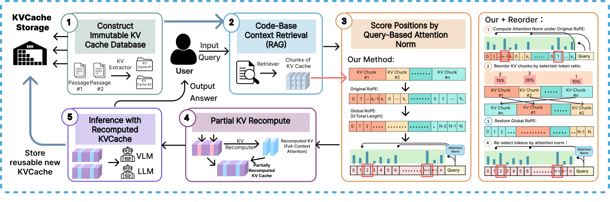

<h1 align="center">InfoFlow KV: Ring and Sequence-Parallel Experiments</h1>

<p align="center">
  <a href="https://arxiv.org/abs/2603.05353"></a>
  <a href="https://infoflow-kv.github.io"></a>
</p>

<p align="center">
  <a href="https://github.com/tx467/InfoFlow-KV/tree/main">Full release</a>
</p>

<p align="center">
  
</p>

This branch contains the multi-GPU sequence-parallel (SP) implementation and its Ring Attention baselines. The standard single-GPU InfoFlow KV pipeline and VLM implementation are on the [`main` branch](https://github.com/tx467/InfoFlow-KV/tree/main).

## Setup

```bash
git clone --branch ring --recurse-submodules https://github.com/tx467/InfoFlow-KV.git
cd InfoFlow-KV

pip install -r models/requirements.txt
pip install -e ring-flash-attention
```

The Ring/SP experiments require multiple CUDA GPUs. The commands below use four GPUs.

## Evaluation

Run the InfoFlow KV sequence-parallel method:

```bash
torchrun --nproc_per_node=4 scripts/eval_longbench.py \
  --model /path/to/Qwen3-14B \
  --tasks hotpotqa 2wikimqa musique \
  --methods sp_guided_recompute \
  --recompute_ratio 0.15
```

Compare against the full Ring Attention prefill baseline:

```bash
torchrun --nproc_per_node=4 scripts/eval_longbench.py \
  --model /path/to/Qwen3-14B \
  --tasks hotpotqa \
  --methods sp_guided_recompute ring_attention \
  --recompute_ratio 0.15
```

Additional supported SP methods are `sp_cacheblend` and `sp_lego`. LongBench v1 and LongBenchV2 are supported.

## Retained experiment scripts

| Script | Purpose |
|---|---|
| `scripts/eval_longbench.py` | Canonical LongBench/LongBenchV2 evaluation entry point |
| `scripts/benchmark_ttft_scaling.py` | TTFT scaling comparison across sequence lengths |
| `scripts/sweep_benchmark.py` | Ring Attention versus SP guided-recompute parameter sweep |
| `scripts/run_eval_all_methods.sh` | Run all SP methods on the LongBench QA tasks |
| `scripts/run_eval_longbenchv2.sh` | Run all SP methods on LongBenchV2 |

The shell launchers contain cluster-specific model and output paths; review those variables before running them.
